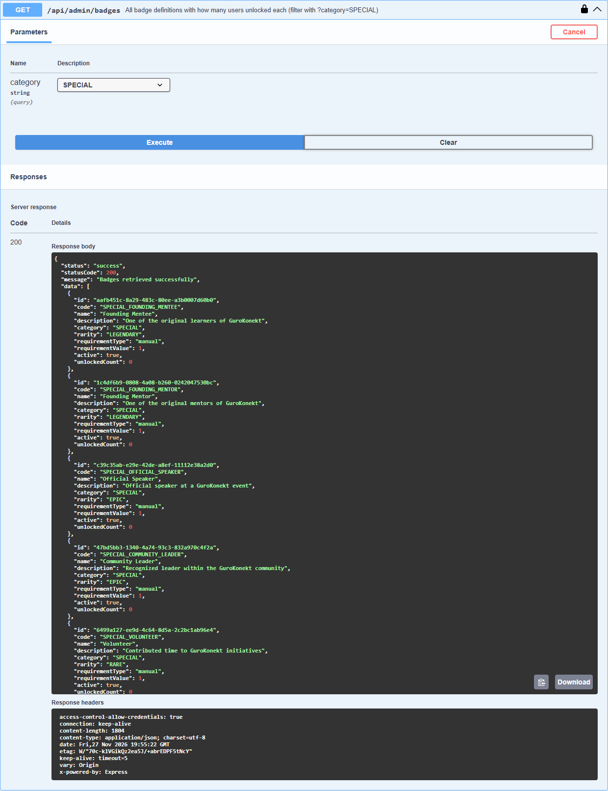
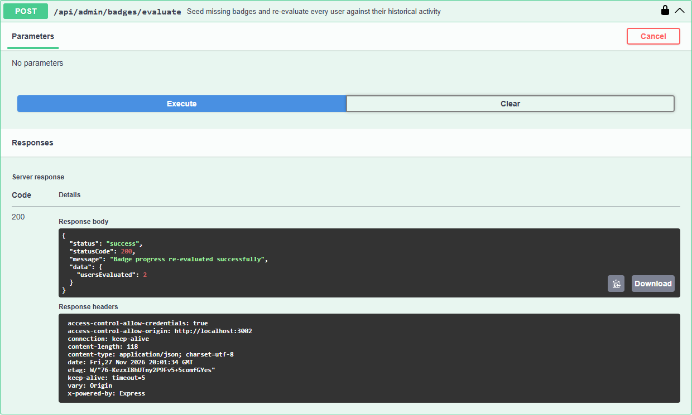
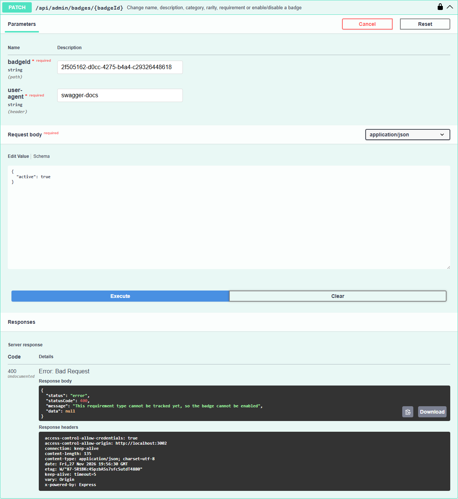
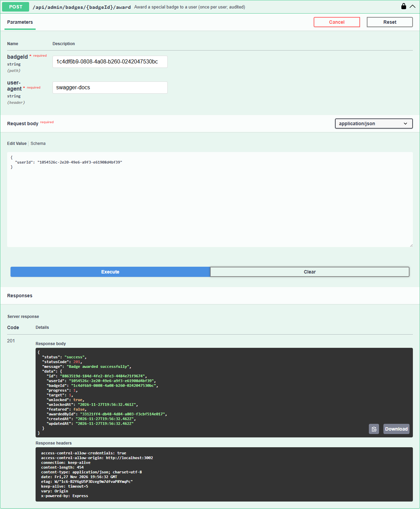
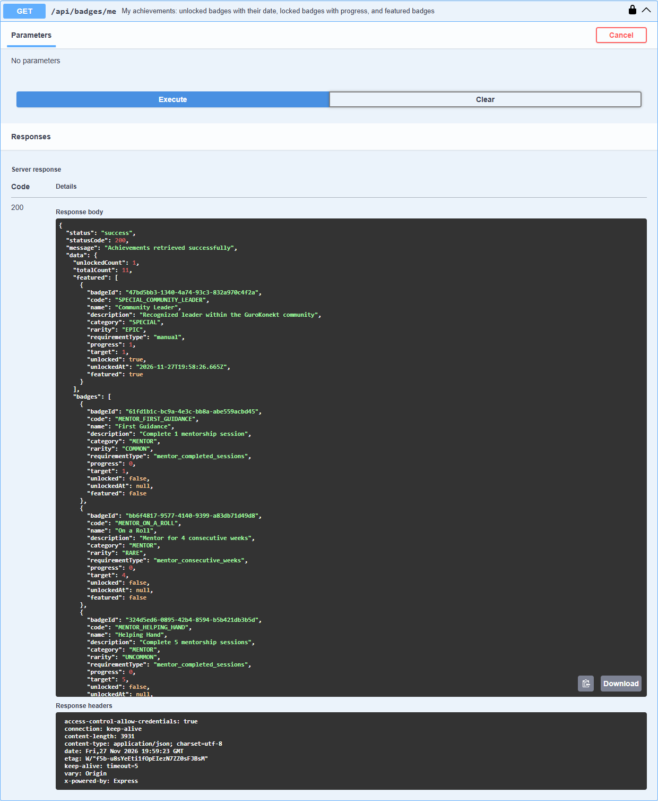
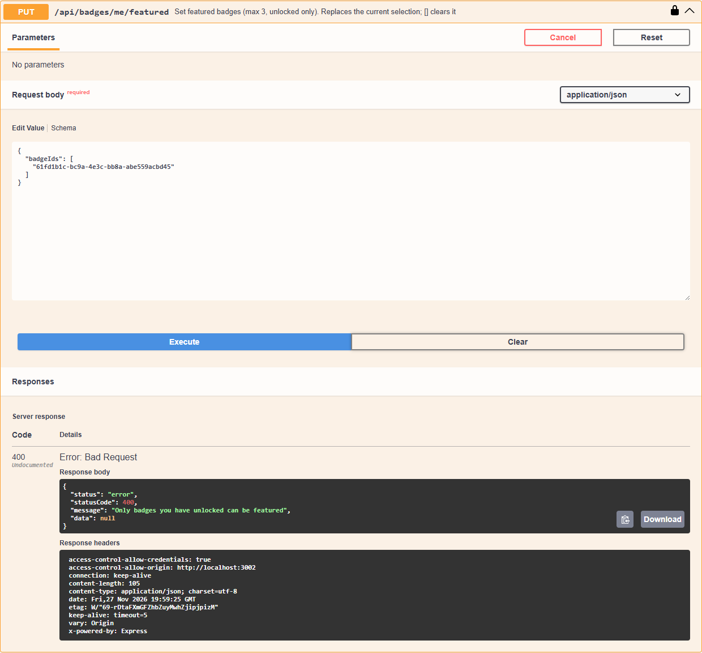
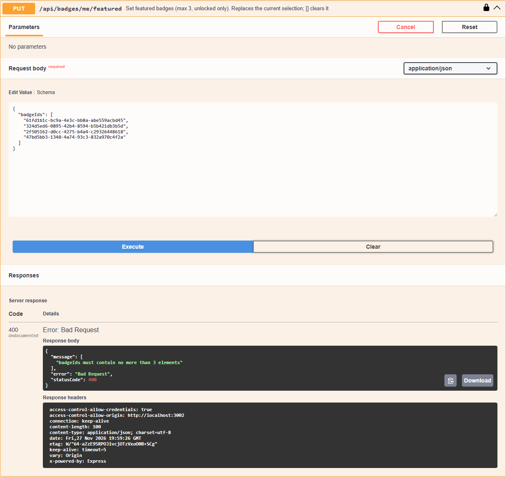
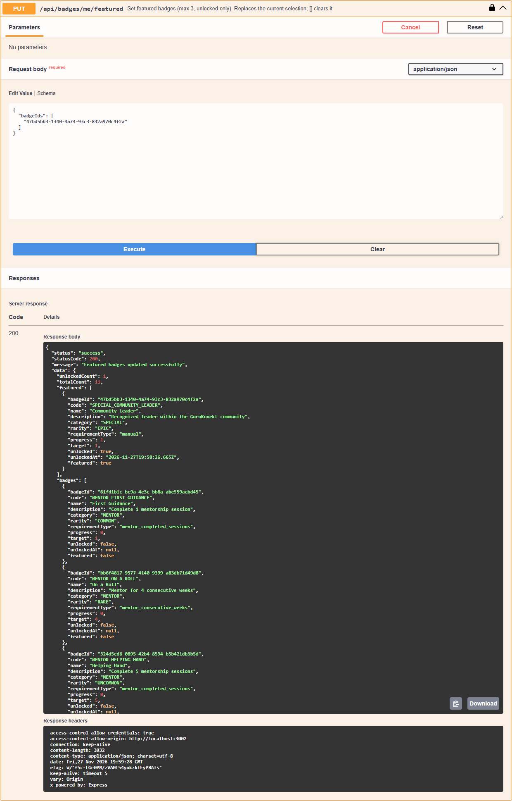
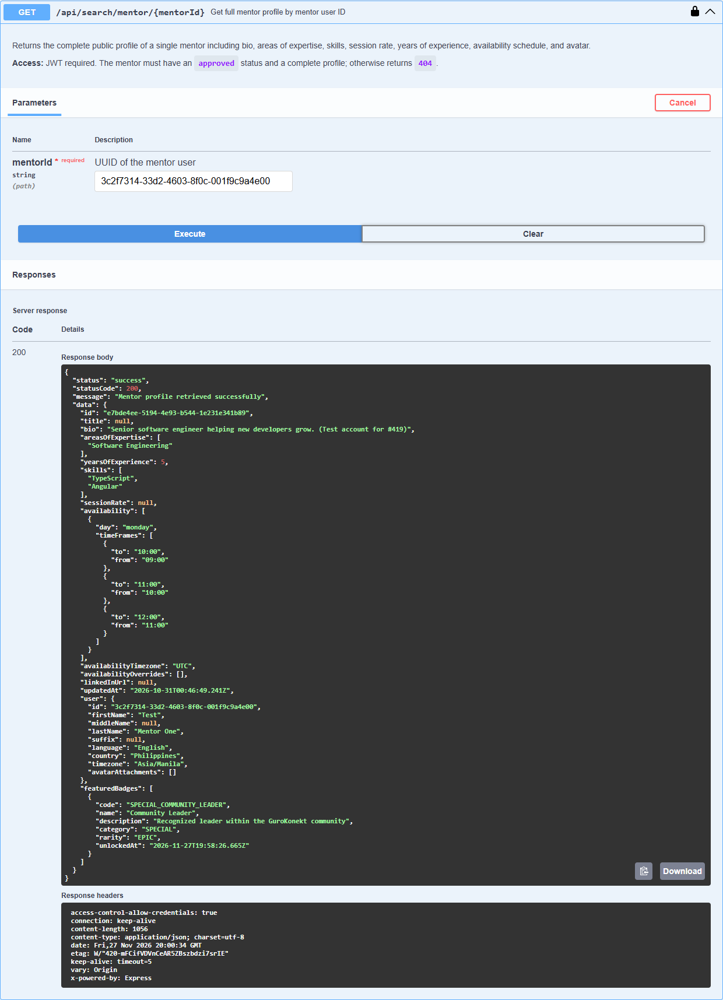
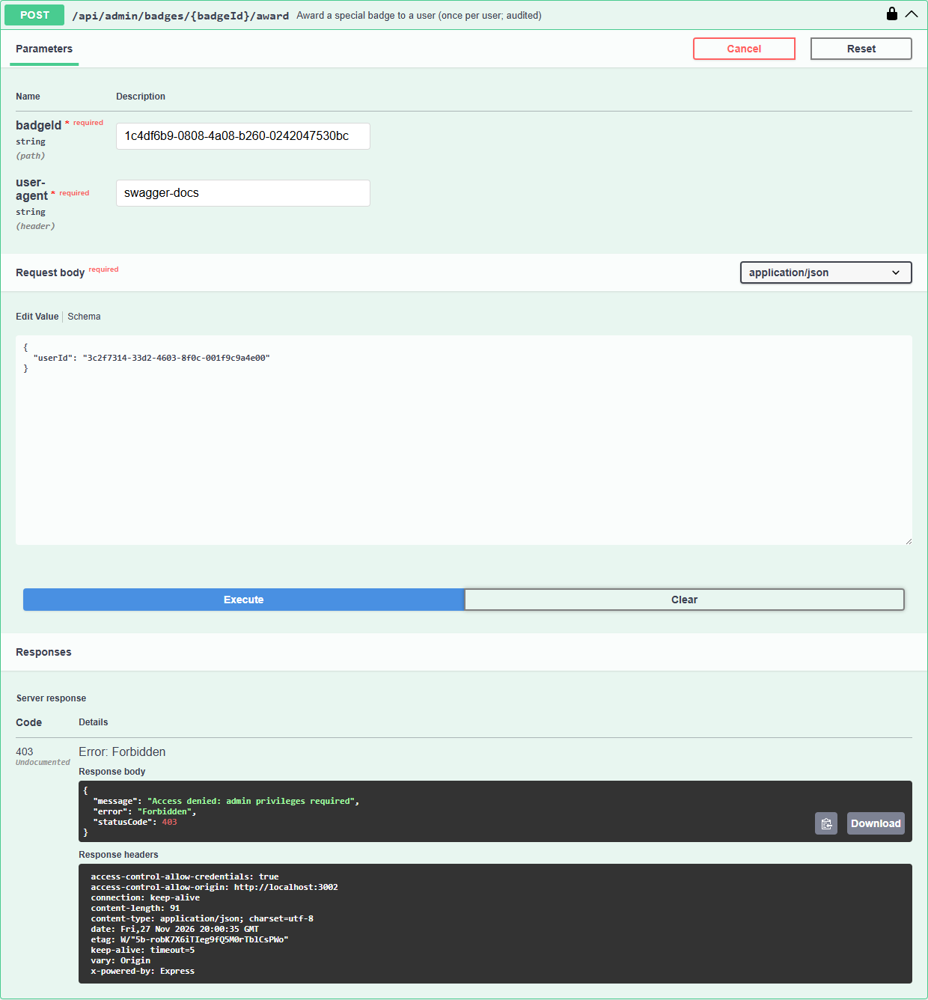

# Badge & Achievement System (backend)

Epic: [#284 Badge Achievements](https://github.com/Angular-PH-X-GuroKonekt-PH/gurokonekt-monorepo/issues/284)
Branch: `feature/284-badge-achievements`
Scope: **backend only**. The profile screen, featured-badge picker and admin award screen are still to be built.

## In short

- Mentors and mentees earn badges automatically when they reach milestones (for example, completing sessions).
- Each badge is either **locked** (shows progress, like 3 / 5) or **unlocked** (shows the date).
- Users can pick up to **3 unlocked badges** to feature on their public profile.
- Admins can give **special badges** (like Founding Mentor) and can change a badge's rarity, category, target or turn it on/off.
- People who used the platform before this feature get credit for their past sessions.

## Sub-tickets

| Ticket | Status |
|---|---|
| #440 Badge data model | Done |
| #441 Seed the 36 badges | Done — 15 mentor, 15 mentee, 6 special |
| #442 Progress tracking | Done |
| #443 Automatic unlocking | Done — runs right after a session is completed or reviewed |
| #444 Mentor badges | 10 of 15 work (see "Not trackable yet") |
| #445 Mentee badges | 8 of 15 work (see "Not trackable yet") |
| #446 Achievements section | Data ready (`GET /badges/me`); screen not built |
| #447 Featured badges | Done (backend); picker screen not built |
| #448 Admin special badges | Done (backend); admin screen not built |
| #449 Credit for past activity | Done — runs on API start and on demand |

## Not trackable yet

These 12 badges are created but **switched off**, because the platform doesn't record the activity yet. The API refuses to switch them on until it can count them.

| Missing data | Badges |
|---|---|
| Learning resources | Knowledge Sharer, Master Educator |
| Events | Community Speaker, Community Builder, Community Learner, Community Explorer |
| Mentor response rate | Quick Responder |
| Learning goals with a "completed" state | Goal Getter, Goal Crusher |
| Courses | Course Graduate, Knowledge Collector |
| Mentor feedback on mentees | Great Mentee |

## Rules we chose (please confirm)

- **Curious Mind** ("actively participate in 5 sessions") counts completed sessions the mentee also reviewed.
- **Weekly streaks** (On a Roll, Learning Streak, Unstoppable) use the longest run of back-to-back weeks with a completed session. Weeks run Monday–Sunday (UTC).
- **Special badge rarity** isn't in the epic; we set Legendary for the Founding badges, Epic for Community Leader, Official Speaker and Contributor, and Rare for Volunteer. Admins can change it.
- Only **completed, non-deleted** sessions count. A badge stays unlocked even if the session behind it is later removed.

## How it works

```text
Session completed / review posted
        |
        v
Recount that mentor's and mentee's activity
        |
        v
Update progress on each badge (never above the target)
        |
        v
Target reached? -- yes --> Unlock once, save the date
```

The same recount runs for everyone a minute after the API starts, and when an admin calls `POST /admin/badges/evaluate`. Running it again never duplicates anything.

## Endpoints

| Who | Endpoint | What it does |
|---|---|---|
| Signed-in user | `GET /api/badges/me` | All my badges: unlocked count, total, featured, and each badge's progress or unlock date |
| Signed-in user | `PUT /api/badges/me/featured` | Set my featured badges (max 3, unlocked only). Send `[]` to clear |
| Anyone signed in | `GET /api/search/mentor/:mentorId` | Mentor profile now includes `featuredBadges` |
| Admin | `GET /api/admin/badges` | All badges with how many users unlocked each (`?category=SPECIAL` to filter) |
| Admin | `PATCH /api/admin/badges/:badgeId` | Change name, description, category, rarity, requirement or on/off |
| Admin | `POST /api/admin/badges/:badgeId/award` | Give a special badge to a user (once per user, logged) |
| Admin | `POST /api/admin/badges/evaluate` | Recount everyone's progress from their history |

## Proof (tested on the test database, 2026-11-28)

Run locally against the shared **test** Supabase project with real test accounts: the admin account and `arw.oloroso+mentor1@gmail.com` (Test Mentor One).

### Admin

**1. All badges are in the database** (filtered to special badges)



**2. Recount past activity** — evaluated the 2 test users who have completed sessions



**3. Can't switch on a badge we can't track yet** (Course Graduate)



**4. Give a special badge** — saves the date and which admin gave it



**5. Giving the same badge twice is blocked**


### Mentor

**6. My achievements** — unlocked special badge (featured) plus locked mentor badges with progress



**7. Can't feature a locked badge**



**8. Can't feature more than 3**



**9. Feature an unlocked badge**



**10. Featured badge shows on the public mentor profile**



**11. A mentor can't give badges** (admins only)



## Automated tests

`apps/api/src/app/badges/badges.service.spec.ts` covers the badge list (15/15/6, unique codes), progress and unlocking, unlock-once and repeat runs, the featured limit and locked check, admin edits, awarding and duplicates, and the backfill. Review creation also checks that it triggers a recount.

```bash
npx nx test api --testFile=apps/api/src/app/badges/badges.service.spec.ts
```

## Not done yet

- Screens: achievements section (#446), featured-badge picker (#447), admin award page (#448).
- Integration / end-to-end tests and the Postman collection.
- No mentee screenshots — the run used admin and mentor accounts only. Mentee badges use the same endpoints and are covered by the automated tests.
