# Mentor Achievement Badges

> **Status:** Draft for review · **Issue:** #419 · **Branch:** `feature/419-mentor-achievement-badges`

## Summary

Mentors can now show **verified badges** for their achievements, such as being a Microsoft MVP,
on their mentor card, their profile and the landing page. Mentees can see at a glance who has
proven experience, and mentors with more badges appear **higher in search**.

Admins decide which achievements exist and how each one is earned:

| Type | How a mentor gets it | Example |
|---|---|---|
| **By application, reviewed** | The mentor applies and uploads proof. An admin approves or rejects it. | Microsoft MVP |
| **By application, auto-approved** | The mentor applies and the badge shows right away. | Community Speaker |
| **Automatic** | The system gives it to every mentor who meets the rules the admin sets. | Seasoned Mentor (5+ years of experience) |

Badges can have an **expiry date**. When one expires it stops showing, and the mentor can renew it.

---

## The flow

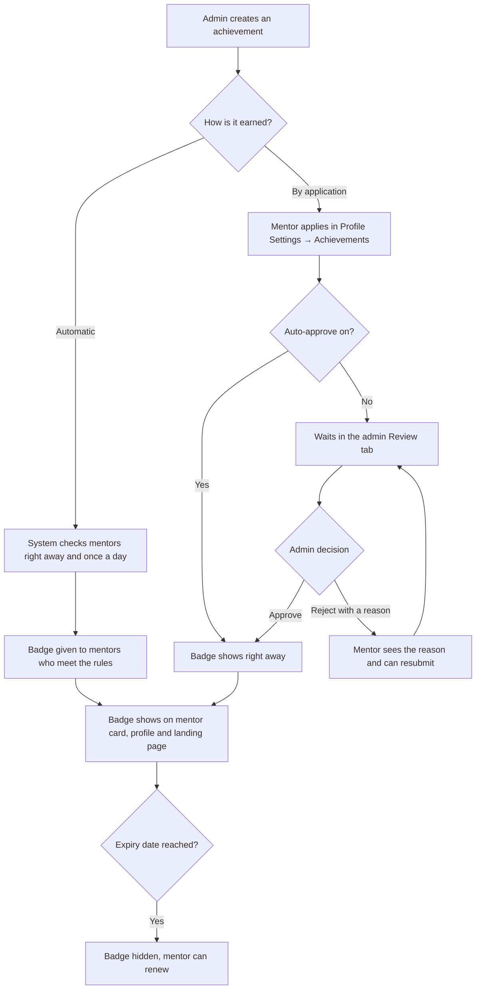

---

## Walkthrough

### Admin: setting up achievements

**1. Creating an achievement mentors apply for.** The admin picks a name, icon and colour, writes
the requirements mentors will see, and chooses whether proof is required, whether it's approved
automatically, and how long it stays valid.

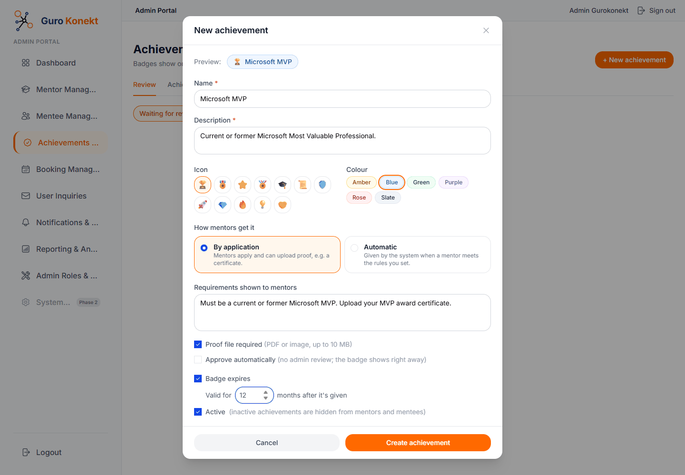

**2. Creating an automatic achievement.** Instead of requirements, the admin sets rules, for
example "Years of experience: at least 5". All rules must be met.

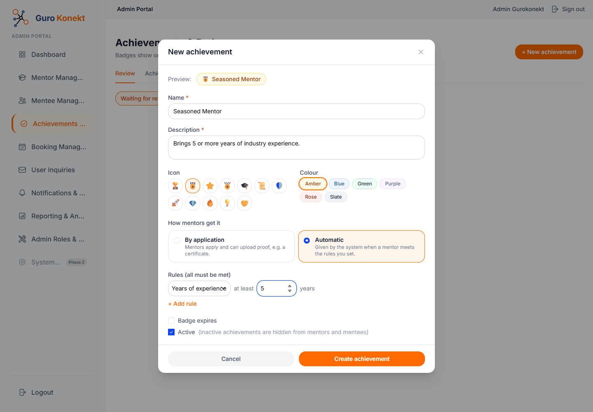

**3. The achievements list.** Shows how each badge is earned, when it expires, and how many
mentors have it. Saving the automatic one gave it straight away to the 6 mentors who already
qualified. "Check now" re-runs the rules on demand.

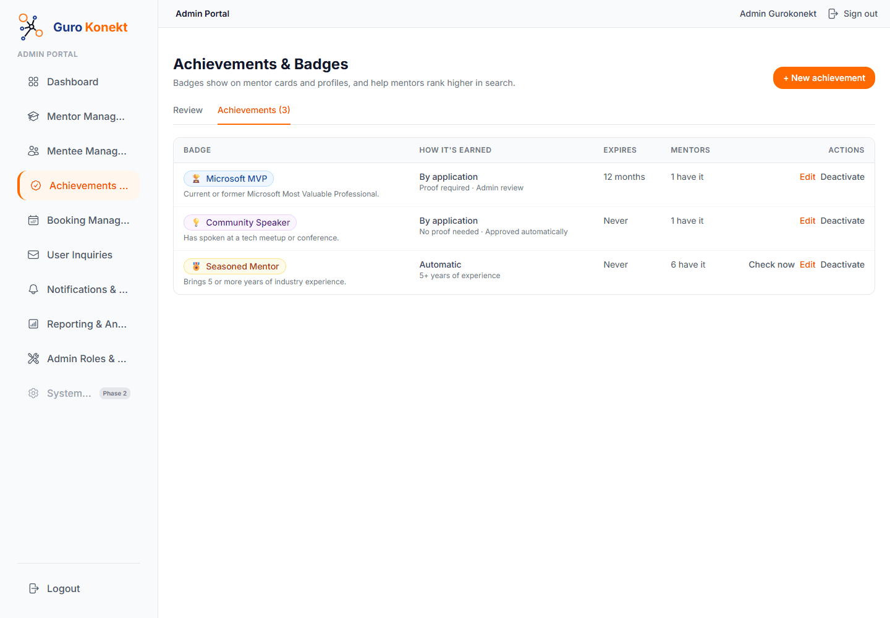

### Mentor: applying

**4. The mentor's Achievements page** (Profile Settings → Achievements, mentors only). At the top,
"What mentees see" previews their badges. Automatic badges show progress towards each rule.

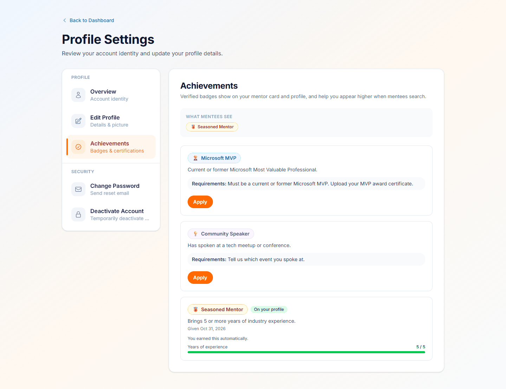

**5. Applying with proof.** The mentor adds optional details and dates and uploads proof
(PDF or image, up to 10 MB). Only admins can open the proof.

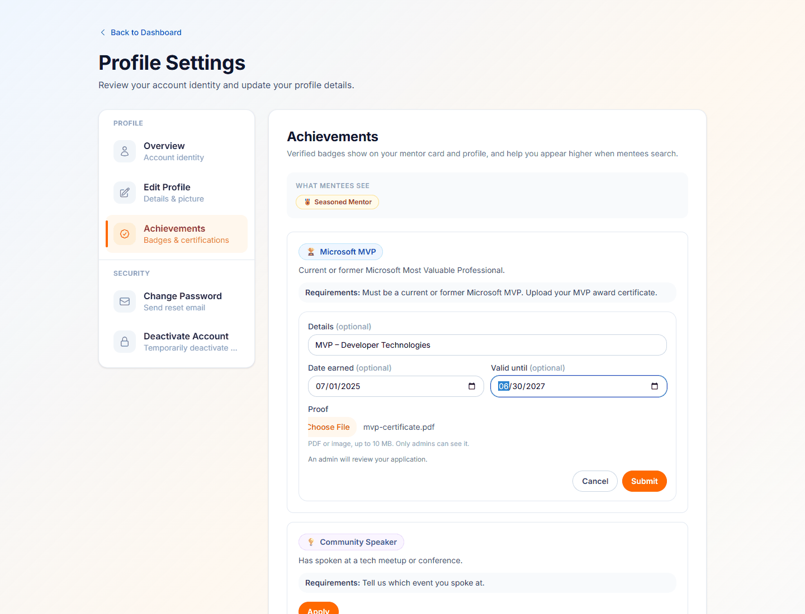

**6. After applying.** Microsoft MVP is "Waiting for review". Community Speaker is auto-approved,
so it's already "On your profile".

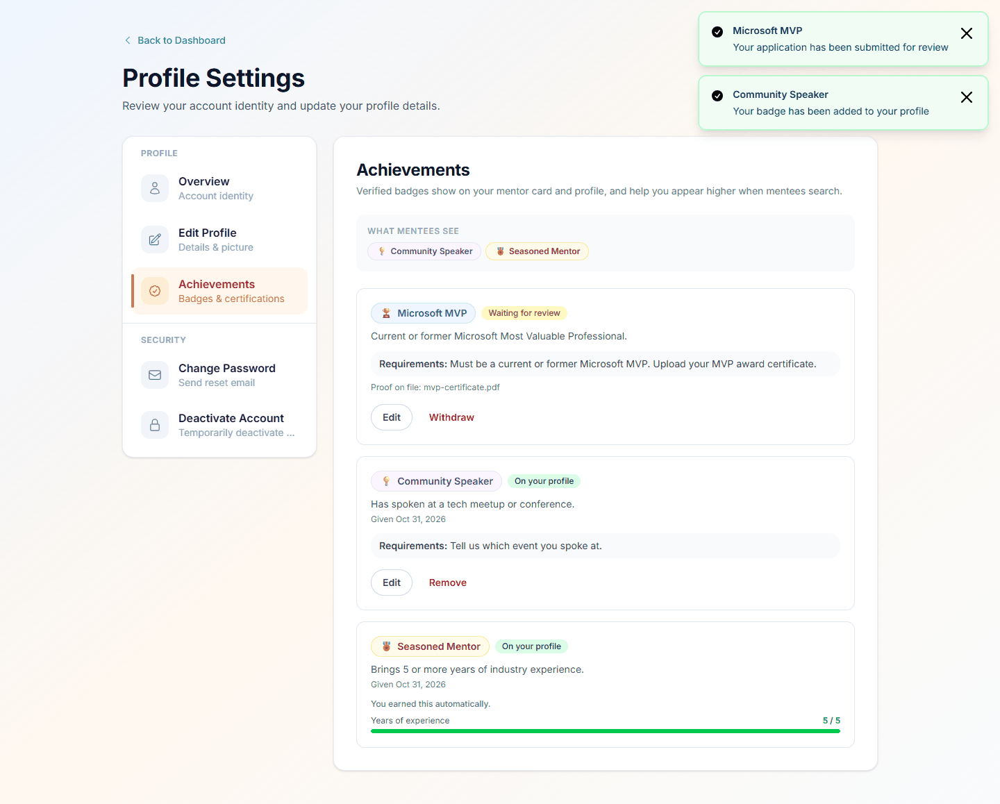

### Admin: reviewing

**7. Rejecting with a reason.** In the Review tab the admin can open the proof (a private link
that expires after 10 minutes). Rejecting needs a reason, which is emailed to the mentor.

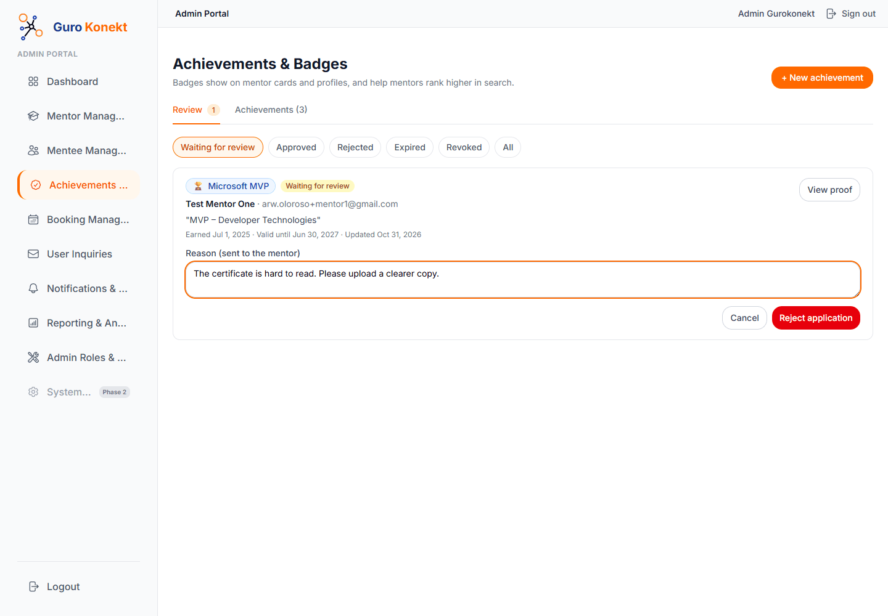

**8. The mentor sees why.** The admin's reason appears on the mentor's page, with an
"Update and resubmit" button.

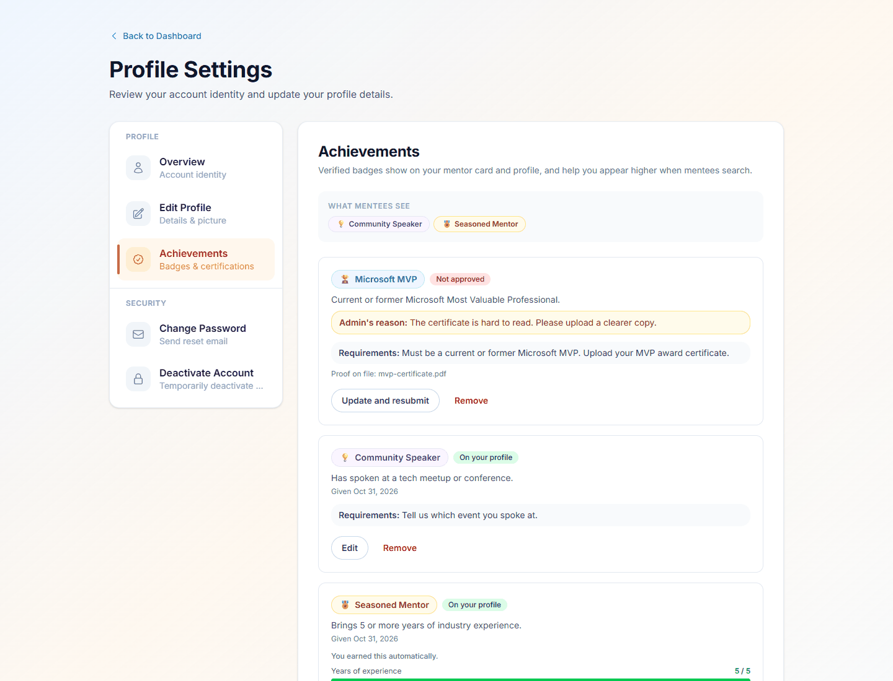

**9. The resubmitted application** is back in the review queue.

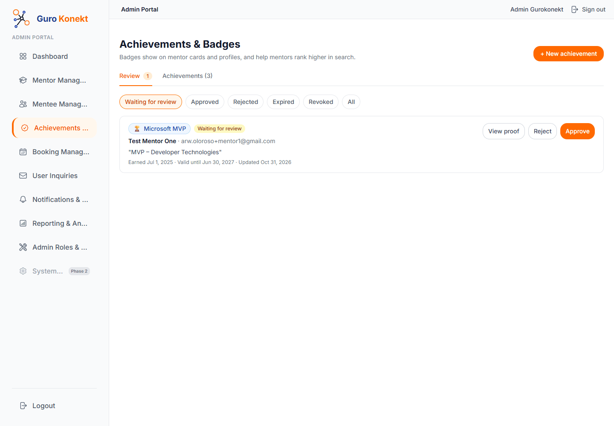

**10. Approved.** The mentor gets an email. The admin can still **Revoke** a badge later, with a
reason.

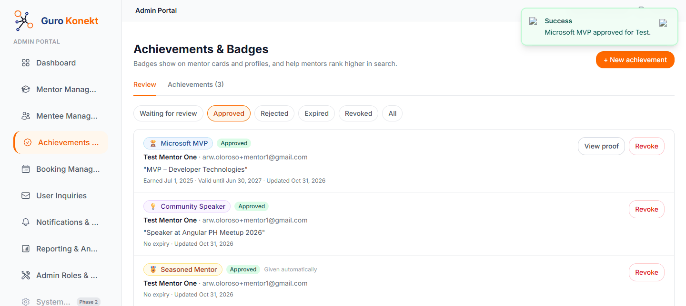

**11. All three badges** now show for the mentor.

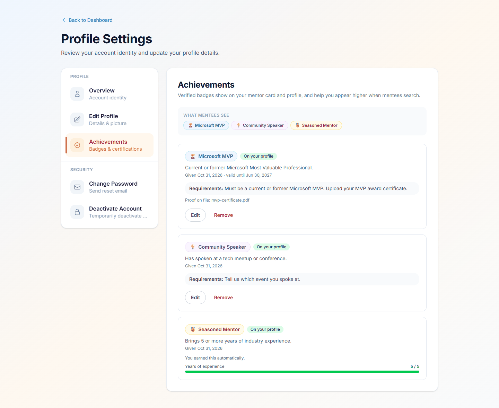

### What mentees see

**12. Find Mentors.** Mentors with more badges are listed first. Here the test mentor ranked
**1st of 16**. (Other mentors are hidden in this screenshot.)

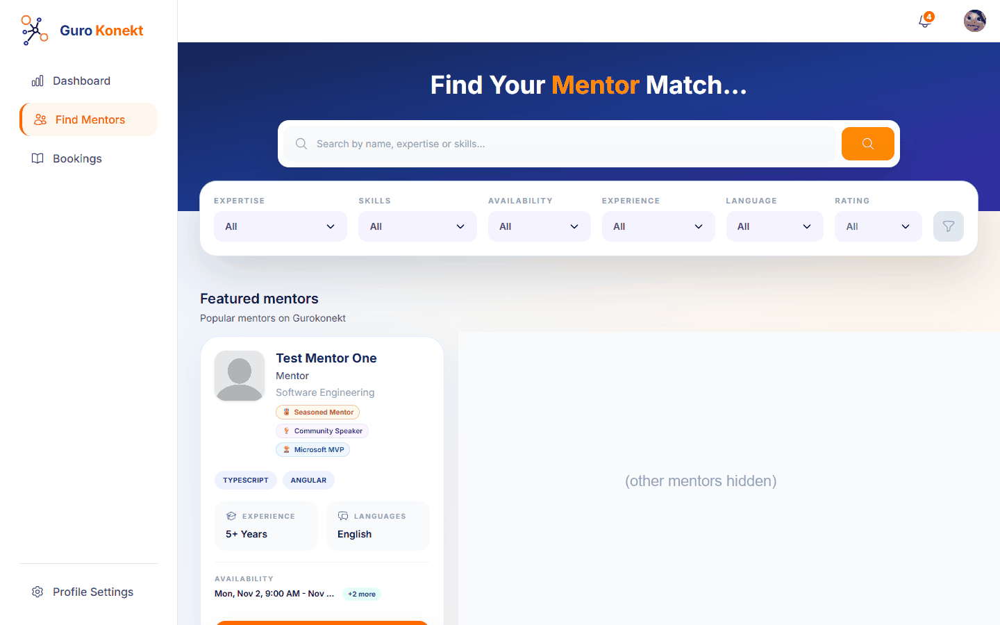

**13. Mentor card.** Badges appear under the mentor's title, up to 3, then "+N more".

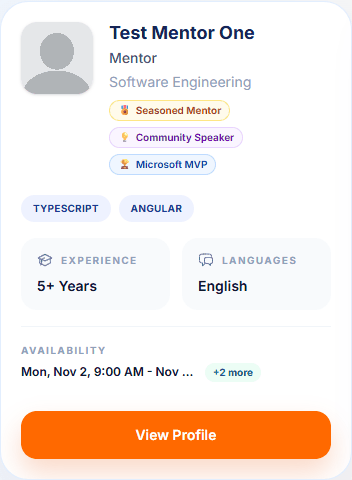

**14. Mentor profile.** Badges appear in the profile header. Hovering one shows its description.

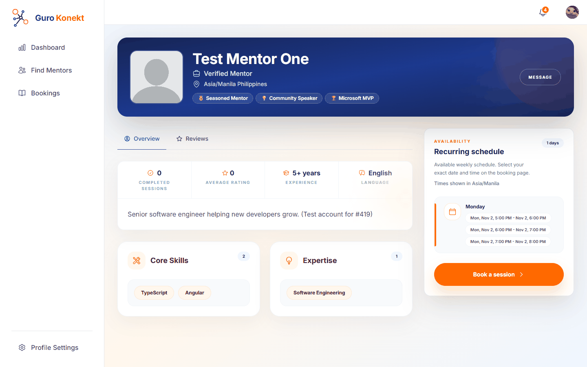

### Landing page

**15. Featured mentors.** Badges also show on the public landing page for featured mentors.

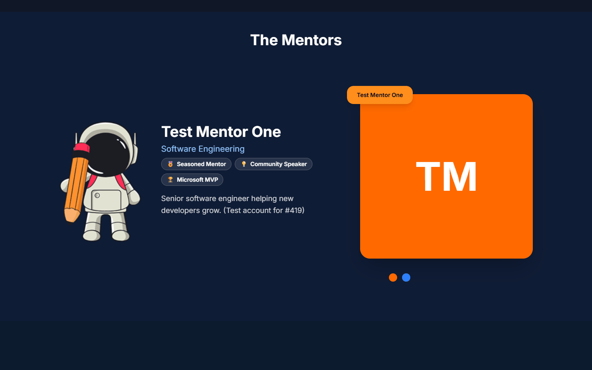

---

## Rules

- **Statuses:** Waiting for review → Approved, or Rejected. An approved badge can later become
  Expired (date passed) or Revoked (by an admin).
- **Only approved, unexpired badges are shown** to mentees and count towards search ranking.
- **Editing an approved badge sends it back for review** (unless that achievement auto-approves).
  It stays hidden until approved again.
- **A revoked badge can't come back through auto-approve.** An admin has to approve it again.
- **Expiry:** the date the mentor enters wins. Otherwise the achievement's "valid for X months"
  applies. Otherwise it never expires.
- **Automatic badges** are checked right after an admin creates or edits one, once a day, and on
  "Check now". An expired automatic badge is given again if the mentor still qualifies. A revoked
  one is not.
- **Automatic rules can use:** completed sessions, average rating, number of reviews, and years
  of experience. Ratings only count reviews from mentees.
- **Deleting:** an achievement can only be deleted if nobody has applied for or earned it.
  Otherwise, deactivate it, which hides it everywhere.
- **Emails** go to the mentor when an application is approved, rejected or revoked. Automatic
  badges don't send emails, so the first check doesn't email many mentors at once.
- **Audit log:** every admin action, application and automatic award is recorded.

---

## Setup

1. **Run the database migration** `20261101000000_add_mentor_achievements`. It adds two tables
   and some audit-log types. It's already applied to the test database.
2. **Nothing else to configure.** The daily check runs inside the API, with no extra service.

---

## Known limitations / follow-ups

- **Proof files are stored in the existing `mentor_documents` storage**, in an `achievements/`
  folder. That storage is public. The app never shares a proof's public link (admins get a
  10-minute signed link), and file names contain a long random ID, but anyone who had the exact
  link could open it. **Move proofs to a private storage area before going live.**
- **Automatic badges don't disappear if a mentor stops meeting the rules** (for example, their
  rating drops). Set a validity period if a badge should be re-earned regularly.
- **Admin Portal toast icons show as broken images.** This already happens on `main`: the icon
  component looks for `assets/icons/*.svg`, which the Admin Portal doesn't have.
- **No admin search or filter by mentor** in the Review tab yet. It lists up to 200 items per
  status.

---

## For developers

### API

| Method | Path | Who | What |
|---|---|---|---|
| `GET` | `/api/achievements` | Mentor | Active achievements with the mentor's status and progress |
| `PUT` | `/api/achievements/:achievementId/application` | Mentor | Apply or update (multipart: `details`, `earnedAt`, `expiresAt`, `proof`, `keepProof`) |
| `DELETE` | `/api/achievements/:achievementId/application` | Mentor | Withdraw or remove (application type only) |
| `GET` | `/api/admin/achievements` | Admin | Catalog with holder and pending counts |
| `POST` | `/api/admin/achievements` | Admin | Create (automatic ones are checked immediately) |
| `PATCH` | `/api/admin/achievements/:id` | Admin | Update (award type can't change) |
| `DELETE` | `/api/admin/achievements/:id` | Admin | Delete if never used |
| `POST` | `/api/admin/achievements/:id/evaluate` | Admin | Check an automatic achievement now |
| `GET` | `/api/admin/achievements/submissions?status=` | Admin | Review queue |
| `GET` | `/api/admin/achievements/submissions/:id/proof` | Admin | 10-minute signed link to the proof |
| `PATCH` | `/api/admin/achievements/submissions/:id/approve` | Admin | Approve |
| `PATCH` | `/api/admin/achievements/submissions/:id/reject` | Admin | Reject (`{ reason }`) |
| `PATCH` | `/api/admin/achievements/submissions/:id/revoke` | Admin | Revoke (`{ reason }`) |

Existing responses now include `badges`: mentor search (`GET /api/search`), mentor profile
(`GET /api/search/mentor/:id`) and featured mentors (`GET /api/public/mentors/featured`). Search
has a new default sort, `recommended`: more active badges first, then newest.

### Where the code is

| Area | Location |
|---|---|
| Database | `apps/api/prisma/schema.prisma` (`Achievement`, `MentorAchievement`) |
| API | `apps/api/src/app/achievements/` (service, metrics, daily scheduler, controllers) |
| Shared types | `lib/models/src/lib/interfaces/achievement/achievement.model.ts`, `lib/models/src/lib/dto/achievement/` |
| Admin Portal | `apps/admin-portal/src/app/features/achievements/` |
| Web (mentor) | `apps/web/src/app/core/profile/pages/profile-achievements-section-page/` |
| Web (badges) | `apps/web/src/app/shared/components/mentor-badges/` |
| Landing page | `apps/landing-page/src/app/components/mentors/` |

### Tests

New unit tests cover applying, auto-approve, review, revoke, automatic awarding, expiry, the
platform numbers behind rules, search ranking, and every new screen. The flow above was also
tested end to end on a local copy against the test database, using test accounts.
